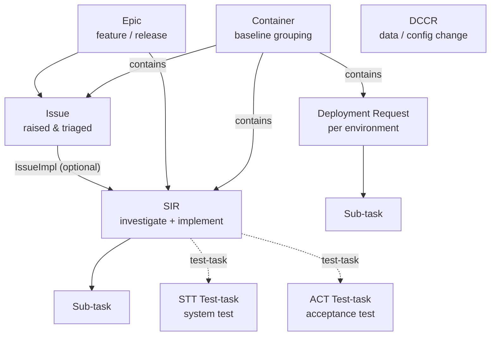

# Jira Skill — T7 / P7

Standard Jira operations for the **T7** and **P7** SDLC pipelines.
Both systems share one Jira instance — `https://devopsjira.deutsche-boerse.com` — and the
same issue-type catalogue and workflows. Every issue key has the form `PROJECT-NNNN`
(e.g. `T7-573588`, `P7-3099`, `T7DEP-7820`). Colloquially, issue keys are referred to as ticket
numbers.

Use the `/devops_jira` MCP to access Jira.

> Ground rule: never invent issue types, statuses, components or transitions. Use only the
> types and states documented here, or read them live from the issue before acting.

## Projects

| Key | Name | Used for |
|-----|------|----------|
| `T7` | T7 | T7 development tickets (Issue, SIR, Container, Sub-task, STT Test-task, DCCR, Epic) |
| `P7` | P7 | P7 development tickets (same type set as T7) |
| `T7DEP` | T7 Deployment | T7 `Deployment Request` tickets (baseline delivery to environments) |
| `P7DEP` | P7 Deployment | P7 `Deployment Request` tickets (configuration delivery to environments) |
| `T7I` | T7 Initiatives | Cross-release T7 initiative Epics |
| `T7CS`, `T7IDG`, `T7OPM`, `T7NODAL`, `T7REFINST` | T7 sub-streams | Specialised T7 work areas |

## Issue Types

| Type | What it is | Project(s) | Subtask? |
|------|-----------|-----------|----------|
| **Epic** | Large feature / release work item, usually named after a spec (e.g. `DFS12200 …`) | `T7`, `P7`, `T7I` | no |
| **Issue** | Generic intake item raised against the product; triaged by *Issue Management* | `T7`, `P7` | no |
| **SIR** | *System Investigation Request* — the investigate-and-implement work item for a defect/change | `T7`, `P7` | no |
| **Container** | "A collection of features, bugs and tasks to be deployed to a target environment" — a baseline grouping | `T7`, `P7` | no |
| **Deployment Request** | Delivery of one baseline (T7) / configuration (P7) to one environment | `T7DEP`, `P7DEP` | no |
| **DCCR** | *Data Configuration or Change Request* — environment-scoped data/config change | `T7`, `P7` | no |
| **Sub-task** | A child work item under any parent (SIR, Container, Deployment Request, …) | all | yes |
| **STT Test-task** | System-test task (owned by the STT team, e.g. *T7 STT Teamleads*); summary `STT: <parent> (<ParentKey>)` | `T7`, `P7` | no |
| **ACT Test-task** | Acceptance-test task (owned by the ACT test team, e.g. *T7 ACT Test Teamleads*); summary `ACT: <parent> (<ParentKey>)` | `T7`, `P7` | no |

### Ticket hierarchy



- When an **Issue** is implemented as a separate work item, that **SIR**'s summary uses the
  `IssueImpl <IssueKey>` convention (e.g. `PricingEngine: IssueImpl P7-264 - …`). Many Issues are
  implemented directly (no SIR), and many SIRs are standalone defects/changes with an
  `<area>: <description>` summary (e.g. `Wrong Tier name template for MDRCosher`).
- A **Container** groups the SIRs/Issues that make up one **baseline/configuration**, plus the
  **Deployment Requests** that deliver it.
- A **Deployment Request** lives in `T7DEP`/`P7DEP` and is broken down into **Sub-tasks**.
- A parent (typically a **SIR**) is verified by **test-tasks**: an **STT Test-task** (system test)
  and/or an **ACT Test-task** (acceptance test), each summarised `"<STT|ACT>: <parent> (<ParentKey>)"`
  (e.g. SIR `T7-573872` → STT `T7-573890` + ACT `T7-573893`).

## Workflows

The flows below are the **official issue-type workflows** (status names exactly as they appear in
Jira). Always add a short comment when you transition an issue, and do not skip states.
`Waiting Ext Input`, `Hold`, `Awaiting Retest` and `Rejected` are side states reachable from the
active states.

### Issue (intake) — *DPT Issue Workflow*
```
Submitted → Analysis started → Analysis complete → Implementation started → Implementation complete → Closed
   side: Hold, Rejected
```
An Issue carries its own **Component** and **Fix Version** and can be implemented directly
(e.g. `T7-566575` — Component `RDS`, Fix Version `15.0`, status `Implementation complete`). When the
implementation is tracked on a separate **SIR**, that SIR's summary uses the `IssueImpl <IssueKey>`
convention.

### SIR — System Investigation Request — *DPT SIR Workflow*
```
Submitted → Analysis started → Analysis complete → Ready 4 Implementation
  → Implementation started → Review started → Review complete → Implementation complete
  → Fixed → Delivered to CM → Ready 4 Installation → Closed
   side: Waiting Ext Input, Hold, Awaiting Retest, Rejected
```
Expected fields: **Component** (e.g. `PricingEngine`, `Architecture`, `GUI`, `TES`, `RDS`),
**Priority/Severity** (e.g. `High`, `Serious Error`), **Fix Version** (release line, e.g. `14.1`,
`15.0`) and `Labels` where relevant (e.g. `required_for_MDH`). Attach evidence (logs/screenshots).

### Container — baseline grouping — *DPT Container Workflow*
```
Submitted → Implementation started → Implementation complete → Fixed → Delivered to CM → Ready 4 Installation → Closed
```
- Named `"<baseline> - <theme>"` (e.g. `141.007.044 - Post PROD fixits`, `011.003.163 - conversion fix …`)
  with a **Fix Version** (e.g. `14.1`).
- Groups SIRs/Issues via the **Container Link** (`contains` / `in container`); tickets can be
  **relocated** between Containers.

### Deployment Request (T7DEP / P7DEP) — *DPT Deployment Workflow*
```
Open → Delivered to CM → Waiting for Approval → Ready 4 Installation → Under Review → Closed
```
- **Waiting for Approval** is the approver gate (set via the *Set Approval* action, owned by the
  environment's approvers, e.g. *T7 CloudSim Approvers*); Production deliveries must pass it before
  `Ready 4 Installation`.
- **Under Review** comes *after* `Ready 4 Installation` — a late/post-installation review observed on
  Production deliveries (e.g. `P7DEP-99`, `Production Delivery of configuration …`); do **not** move a
  request there before installation.
- Broken down into **Sub-tasks** (e.g. `T7DEP-7843`, which carry status `Open`).
- Summary pattern: `"<Environment> Delivery of baseline <version>"` (T7) /
  `"<Environment> Delivery of configuration <version>"` (P7).

### STT Test-task — *DPT STT Test-task Workflow*
```
Open → In Preparation → System Test started → System Test complete → Closed
```
System-test task (in both `T7` and `P7`) owned by the STT team (*T7 STT Teamleads*); summary
references its parent as `"STT: <parent summary> (<ParentKey>)"` (e.g. `T7-573890` → SIR `T7-573872`;
`P7-2868` → SIR `P7-2842`).

### ACT Test-task — acceptance-test sibling of STT *(no diagram supplied)*
```
Open → Acceptance started → Acceptance complete → Closed
```
Acceptance-test task (in both `T7` and `P7`) owned by the ACT test team (*T7 ACT Test Teamleads*);
summary `"ACT: <parent summary> (<ParentKey>)"` (e.g. `T7-573893` → SIR `T7-573872`). The states above
are the live-observed statuses; an `In Preparation` state likely exists (mirroring STT) — **read the
issue's available transitions before transitioning**.

### Epic (T7 Initiative) — *T7I Default Workflow*
```
Backlog → In Analysis → In Specification → In Review → Under Estimation
  → Waiting for Approval → Approved → In Implementation → In Test → Closed
   side: Awaiting Clarification
```
Verified on `T7I-321` (Epic, status `In Test`). Epics in `T7`/`P7` may follow a simpler
`To Do → In Progress → Closed` scheme — confirm on the issue.

### DCCR — Data Configuration or Change Request — *DPT DCCR Workflow*
```
Submitted → Analysis started → Review started → Review complete → Analysis complete
  → Internal Test started → Internal Test complete → Ready 4 Installation → Installed
   side: Rejected
```
Scoped to one environment (see **Environment tokens** below — `SIM`/`SIMU`, `ACT`, `PROD`/`PRD`, `DR`,
`VET`, …); state the target environment in the summary (e.g. `T7-573885` —
`"T7 BF SIMU - Add FAGSE Sessions XFRA"`; `P7-3095` — `"PROD - VET - RCB Broker …"`). Terminal state is
**Installed** (not `Closed`).

### Sub-task
```
T7/P7 dev sub-tasks:  To Do → In Progress → Closed
Other sub-tasks:      Open → … → Closed   (e.g. T7DEP delivery sub-tasks use `Open`)
```
> No Sub-task workflow diagram was supplied and the states differ by parent project (`To Do` vs
> `Open`). **Always read the sub-task's live available transitions before transitioning it** — do not
> assume the states above.

## Deployment / promotion model

A Container is promoted environment-by-environment; each promotion is recorded **on the Container**
by its Deployment Request using this comment format:

```
*Installed* in *<Environment>* via Deployment Request <KEY> (<Environment> Delivery of baseline <version>) on <date>
*Approved* for *<Environment>* via Deployment Request <KEY> (…) on <date>
```

Promotion stages (low → high): **Simulation → Acceptance → Production** (Production gated by approval).

| System | Environments | Versioned artefact |
|--------|--------------|--------------------|
| **T7** | `Nodal-Simulation`, `CloudSim`, `BF-Simulation`/`STD-Simulation`, `BF-Acceptance`/`STD-Acceptance`, `BF-Production`/`STD-Production` (`BF`/`STD` are parallel streams; `RH8`/`RH9` denote the RHEL variant) | **baseline** `NNN.NNN.NNN` (e.g. `141.007.044`) |
| **P7** | `Simulation`, `Acceptance`, `Production` | **configuration** `NNN.NNN.NNN` (e.g. `011.004.012`) |

### Environment tokens

Short tokens used in DCCR / Deployment summaries map to the promotion stages above:

| Token(s) | Environment / stage |
|----------|---------------------|
| `SIM`, `SIMU` | Simulation (`BF-Simulation`, `STD-Simulation`, `Nodal-Simulation`, `CloudSim`) |
| `ACT` | Acceptance (`BF-Acceptance`, `STD-Acceptance`) |
| `PROD`, `PRD` | Production (`BF-Production`, `STD-Production`) |
| `DR` | Disaster-recovery environment (e.g. `T7 DR`) |
| `VET` | A P7 environment (token confirmed in live tickets, e.g. `P7-3095`; its acronym is **not** spelled out in Jira — do not invent an expansion) |

> Tokens above are taken verbatim from live summaries (`T7 STD SIM …`, `T7 STD PRD …`, `T7 DR …`,
> `PROD - VET - …`). Always copy the environment exactly as the ticket/baseline uses it.

## Linking & relationships

| Link / relation | Use |
|-----------------|-----|
| **Container Link** (Jira link type; outward `contains`, inward `in container`) | Attach SIRs, Issues and Deployment Requests to their Container |
| `relates to` | General association between tickets |
| `blocks` / `is blocked by` | Dependency between tickets |
| `duplicates` / `is duplicated by`, `causes` | De-duplication / root-cause links |
| Parent ↔ Sub-task | Break a SIR / Container / Deployment Request into Sub-tasks |
| `IssueImpl <IssueKey>` (summary convention) | Tie an implementing SIR back to its source Issue |

## GitHub ↔ Jira integration

Tie code to the ticket so the Jira **development panel** auto-links the branch, commits and PR.
(See the `github` skill for the commit/branch/PR templates.)

- **Branch name** contains the key: `{KEY}-{short-desc}` — e.g. `P7-3099-theo-price-sim`.
- **Commit message** references the key, optionally as a **Smart Commit**:
  `P7-3099 #comment Fix theo-price simulation #time 2h`
  (`#comment` and `#time` are safe. **Avoid `#resolve`/`#close`** in commits — they jump the issue to a
  resolved state and would skip the multi-state T7/P7 workflows; transition explicitly instead.)
- **PR title** starts with the key: `P7-3099: Fix theo-price simulation for index futures`.
- Move the ticket to its review/verification state only once the PR is open; resolve it only after merge.

## Operations (for SDLC agents)

> **Prerequisite (access):** the calling agent must whitelist the Jira MCP server in its `tools:`
> frontmatter — `devops_jira/*`, or specific tools like `devops_jira/get_my_issues`. VS Code surfaces
> these as `mcp_devops_jira_<tool>`; **do not** prefix the names yourself (`get_my_issues`, *not*
> `devops_jira_get_my_issues`). If an agent claims "no Jira integration is configured", the tool grant
> is missing — the server itself is available.

### Jira MCP tools (`devops_jira`)

Call these directly, guided by the conventions in this skill. The common ones:

| Intent | Tool | Notes |
|--------|------|-------|
| **List my assigned tickets** | `get_my_issues` | `assignee = currentUser()`, newest first — the one-call happy path. Optional `extra_jql` (e.g. `resolution = Unresolved`). Spans **every** project. |
| Tickets assigned to someone | `get_issues_assigned_to` | pass the `user`. |
| Run arbitrary JQL | `search_issues` (alias `run_jql`) | anything the convenience tools don't cover — see the JQL cookbook below. |
| Read one ticket | `get_issue` | full detail by key (e.g. `T7-573588`). |
| Comments / changelog / links / worklogs | `get_issue_comments` · `get_issue_changelog` · `get_issue_links` · `get_issue_worklogs` | read-only. |
| Available transitions | `get_transitions` | **read before transitioning** — never assume state names. |
| Create / update / transition / comment / link | `create_issue` · `update_issue` · `transition_issue` · `add_comment` · `link_issues` | respect the workflows above; do not skip states. |
| Boards / sprints / epics | `list_boards` · `list_sprints` · `get_sprint_issues` · `get_epic_issues` | Agile queries. |

> **"List all my assigned tickets"** (no project/status filter) = `get_my_issues` with no extra JQL — it
> already spans every project (`T7`, `P7`, `T7DEP`, `P7DEP`, …). Do not restrict to one project, and do
> not ask the user to pick a status, unless they said so.

### Access model — least privilege by agent

Jira access is **scoped per agent to its role**: an agent is granted only the specific `devops_jira/<tool>`
names it needs (not the whole server). **No agent** is granted `delete_issue`, `delete_comment` or bulk
creation — write access is confined to the two roles that genuinely mutate Jira.

| Agent | Access | Jira tools granted | What it does with them |
|-------|--------|--------------------|------------------------|
| **Planner** (p7/t7) | **write** (triage) | `get_issue`, `get_issue_comments`, `get_issue_links`, `search_issues`, `get_transitions`, `get_create_meta`, `create_issue`, `update_issue`, `transition_issue`, `add_comment`, `link_issues` | Triage: create/refine the Issue & SIR, set Component/Fix Version, transition through analysis, link to the Container |
| **PR author** (p7) | **write** (PR link/status) | `get_issue`, `get_issue_links`, `search_issues`, `get_transitions`, `transition_issue`, `add_comment`, `link_issues`, `create_remote_issue_link` | Link the PR to the ticket, move it to its review/verification state, comment; resolve only after merge |
| **Developer** (p7/t7) | **read** | `get_issue`, `get_issue_comments`, `get_issue_links`, `search_issues` | Read the SIR/Issue being implemented for requirements & linked context |
| **Reviewer** (p7/t7) | **read** | `get_issue`, `get_issue_comments`, `get_issue_links`, `search_issues` | Read the ticket & linked issues to check the change against stated intent |
| **Architect** (p7) | **read** | `get_issue`, `get_issue_comments`, `get_issue_links`, `search_issues` | Read the referenced ticket for design context |
| **Tester** (p7) | **read** | `get_issue`, `get_issue_comments`, `get_issue_links`, `search_issues` | Read acceptance criteria & linked test context |
| **Knowledge** (t7) | **read** (query endpoint) | `get_my_issues`, `get_issues_assigned_to`, `search_issues`, `run_jql`, `get_issue`, `get_issue_comments`, `get_issue_links`, `get_issue_changelog`, `get_transitions`, `get_project_issues`, `get_epic_issues`, `list_projects` | Cross-system read-only: "list my tickets", look up any ticket, run JQL across all projects |
| **Builder** (p7) | **none** | — | Compilation only — no Jira touchpoint |
| **Orchestrators** (gts/p7/t7) | **none** (delegate) | — | Coordinate only; **delegate** any Jira write to the phase agent |
| **Clarifier** | **none** | — | Carries the jira *skill* for routing knowledge; performs no Jira calls |

> Only **Planner** (triage/create) and **PR author** (PR linking/status) may write; everyone else is
> **read-only** or has no Jira access. Respect the workflows above, never skip states, and escalate
> role-owned transitions (approvals, STT/ACT test-task ownership) instead of forcing them.

Agents may **create, transition, comment on and link** any of the documented types
(Epic, Issue, SIR, Container, Deployment Request, DCCR, Sub-task, STT/ACT Test-task). When creating:

- Set `project`, `issuetype`, a convention-compliant `summary`, a clear `description`, and
  `components` for `T7`/`P7` work items. Add `labels`/`priority` when known.
- For a SIR implementing an Issue, use the `IssueImpl` summary convention and link it to the Issue
  and to the relevant Container.
- For a Deployment Request, create it in `T7DEP`/`P7DEP`, name it `<Env> Delivery of …`, and link it
  into the Container it delivers.
- Many states are **role-owned** (e.g. *Issue Management* triages Issues; *STT/ACT Test Teamleads* own
  test-tasks; *DCCR Management* owns DCCRs; environment *Approvers* set deployment approval). If a
  transition fails with a permission error, **escalate to the owning team — do not retry or force it**.

### JQL cookbook

> JQL has **no comment syntax** — send only the query line(s), not the descriptions.

Open SIRs I own in P7:
```jql
project = P7 AND issuetype = SIR AND assignee = currentUser() AND statusCategory != Done
```
Everything contained in a baseline Container:
```jql
issue in linkedIssues("T7-573588", "contains")
```
SIRs still needing analysis:
```jql
project in (T7, P7) AND issuetype = SIR AND status = "Submitted" ORDER BY priority DESC
```
Deployment Requests awaiting installation:
```jql
project in (T7DEP, P7DEP) AND status = "Ready 4 Installation" ORDER BY created DESC
```
Containers not yet delivered:
```jql
project = P7 AND issuetype = Container AND status != Closed ORDER BY fixVersion
```

## Conventions & guardrails

- **Summaries**: SIR → `"<area/component>: <what>"` (add `IssueImpl <IssueKey>` only when the SIR
  implements an Issue); Container → `"<baseline> - <theme>"`; Deployment Request →
  `"<Env> Delivery of baseline|configuration <version>"`; STT/ACT Test-task →
  `"STT|ACT: <parent summary> (<ParentKey>)"`; Epic → spec/initiative name.
- Always set the **Component** on `T7`/`P7` development tickets; it drives ownership and routing.
- Record the **affected baseline/configuration** on SIRs and the **Fix Version** on Containers.
- Do **not** skip workflow states, and do **not** move a Production Deployment Request to
  `Ready 4 Installation` without passing the **Waiting for Approval** (*Set Approval*) step.
- A code-bearing SIR/Sub-task should have its **PR linked** (via key) before it is closed.
- `SIR` = **System Investigation Request** (not "incident") and `DCCR` = **Data Configuration or
  Change Request** — use the exact type names; never substitute generic `Story`/`Bug`/`Task`.
