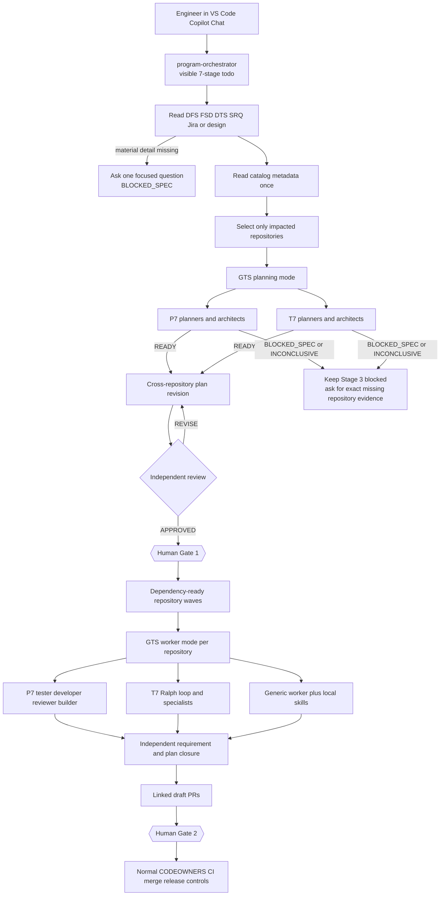
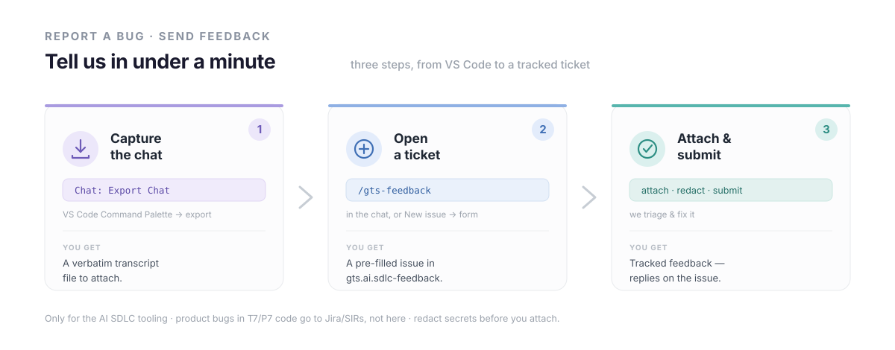

<p align="center">
  
</p>

<p align="center">
  
  
  
  
  
  
</p>

<p align="center">
  <b>A VS Code-based agentic SDLC</b> — specialist AI agents that run the full development lifecycle across <b>P7</b> and <b>T7</b>.
</p>

<p align="center">
  <a href="https://pages.github.deutsche-boerse.de/dev/gts.ai.sdlc/explorer/"></a>
  &nbsp;
  <a href="https://pages.github.deutsche-boerse.de/dev/gts.ai.sdlc/explorer/#setup"></a>
  &nbsp;
  <a href="https://pages.github.deutsche-boerse.de/dev/gts.ai.sdlc/explorer/#evals"></a>
</p>

<h3 align="center">
  <a href="#where--when-you-use-it">Where &amp; When</a> &nbsp;·&nbsp;
  <a href="#architecture-at-a-glance">Architecture</a> &nbsp;·&nbsp;
  <a href="#enterprise-multi-repository-mode">Multi-repo</a> &nbsp;·&nbsp;
  <a href="#the-sdlc-pipeline">The Pipeline</a> &nbsp;·&nbsp;
  <a href="#supported-systems">Systems</a> &nbsp;·&nbsp;
  <a href="#design-principles">Design</a> &nbsp;·&nbsp;
  <a href="#get-started">Get Started</a>
</h3>

<p align="center"></p>

## Where & when you use it

<p align="center">
  
</p>

Open the repo in VS Code and the whole team is already there — Copilot auto-discovers every
`.github/agents/*.agent.md`, so you run the **whole lifecycle** or call a **single phase** with zero setup.
For unknown or multi-repository scope, select `program-orchestrator`; it discovers which GTS system and
repositories own the change. The original direct routes remain available for focused work.

> **One writer, always gated.** Only the **developer** edits code — every other agent coordinates or reads.
> Nothing reaches a PR until the tester, reviewer and builder gates pass. Human Gate 1 confirms the reviewed
> plan before code is written; Human Gate 2 occurs before PR approval or merge.

<p align="center"></p>

## Architecture at a glance

For focused work the framework keeps its original **3-tier composition model**: GTS router, system
orchestrator, then single-purpose pipeline agents. Multi-repository work adds only one thin parent above GTS;
it selects repository scope and dependency waves while reusing every original agent and skill. Alongside them sit two read-only cross-system peers:
**`gts-issue-analyst`**, which runs root-cause analysis on engineering issues and feeds fixes back into the
pipeline, and **`gts-delivery`**, which proposes the terminal delivery of a merged change into an integration baseline.

<p align="center">
  
</p>

<p align="center"></p>

## Enterprise multi-repository mode

The original GTS agents remain the domain experts. `program-orchestrator` is a thin agent layer above GTS:
it handles repository discovery, the cross-repository plan, dependency waves, independent closure and the two
human gates. GTS still routes domain work to the existing P7 and T7 orchestrators. There is no Python
control-plane runtime in this path.



### What happens with 90 repositories

The parent reads descriptor metadata for the catalog once and uses ownership, paths, contracts, dependencies,
components and system metadata to select impact. It opens source and starts agents only for the selected
repositories.

| Example impact | Execution |
|---|---|
| 1 implementation repository | One isolated worker; both human gates still apply |
| 3 repositories with dependencies | Producer first, then independent consumers in the next wave |
| 8 independent repositories | Bounded parallel workers with one task context per repository |
| 50–60 catalogued, 3–8 active | Only the selected repositories enter bounded waves |
| 90 catalogued but 4 active | Four active workers, not ninety |

Every repository does **not** copy the complete SDLC. The control centre holds the parent agent and common
skills. A target repository contributes only its local descriptor and any real local expertise:

```text
target-repository/
├─ .github/sdlc/repository.json       # identity, ownership, contracts, commands, dependencies
├─ .github/copilot-instructions.md    # optional local rules
├─ .github/agents/*.agent.md          # optional local specialists
└─ .agents/skills/*/SKILL.md          # optional local expertise
```

Add a central descriptor under `.github/sdlc/repositories.d/` using
`.github/sdlc/examples/repository.json` as the template. When selected, GTS passes its registered local agents,
instructions and skills to the P7/T7 or generic worker as additive expertise. Local rules may strengthen the
central plan and gates but cannot weaken them.

Each active implementation or validation repository needs a registered owner, immutable base commit and either
a resolvable local checkout or approved remote. Provisional repository names in a chat may help impact analysis,
but they cannot open plan review or Human Gate 1. A missing execution identity stops Stage 3 as `BLOCKED_SPEC` or
`INCONCLUSIVE` instead of triggering broad workspace searches or a substitute plan.

Only an impacted repository is reused or cloned. A dirty developer checkout is never switched, cleaned or
overwritten; implementation uses an isolated worktree. The approach is language-neutral: C++/CMake, Python,
Node, Vite and TypeScript repositories keep their own test, lint, build, security and GUI commands.

### The two loops and two gates

- The **outer agent loop** handles scope, repository dependencies, plan revision and integration.
- The **inner P7/T7 loop** handles one approved task in one repository with bounded test, implementation,
  review and build backpressure.
- **Human Gate 1** approves the latest independently reviewed plan revision only after every required system plan
  is ready and every active repository has a registered execution identity.
- **Human Gate 2** reviews traceability, evidence and linked draft PRs before approval, merge, release or delivery.

The plan is re-reviewed only after a real finding or material change. A scope change after Gate 1 returns to
planning and requires Gate 1 again. Missing evidence is `INCONCLUSIVE`; missing authoritative intent is
`BLOCKED_SPEC`. No finite chain promises defect-free software.

<p align="center"></p>

## The SDLC pipeline

Each system binds the same lifecycle to its own agents. Every Tier 3 worker ends its turn with a
**status code**, and the orchestrator routes on it — that status contract is what makes the pipeline
autonomous yet gated.

<p align="center">
  
</p>

**Two shapes, one contract.** P7 runs this straight through as a **linear TDD pipeline**; T7 runs it as an
**autonomous Ralph loop** — specs are the source of truth, the plan is disposable, and each iteration
converges one task under tester + builder backpressure.

<p align="center"></p>

## Supported systems

<p align="center">
  
</p>

> **Every system has a knowledge agent.** `p7-sdlc-knowledge` and `t7-sdlc-knowledge` answer read-only
> "where / who owns / what changed" questions directly — no plan, gate or build cycle.
>
> **Issues get a read-only analyst.** `gts-issue-analyst` — a cross-system peer of the knowledge agents —
> runs root-cause analysis on a red Jenkins build, a SonarQube finding, a Dependabot/CodeQL/secret alert, a
> GitHub issue or a Jira SIR (selecting jenkins-lens / sonarqube-lens / GitHub), grounds it in the code, and
> hands any fix back to the pipeline. It **diagnoses, never implements**.
>
> **Delivery is proposed, never auto-run.** `gts-delivery` — the other cross-system peer — is the terminal
> **deliver** step after Build and PR: it runs read-only readiness gates and **proposes** the exact
> `gts-deliver` command that ships a merged change into an integration baseline (the human runs it), then
> watches the resulting Integration build. It **proposes, never executes**.
>
> **Specs are on-demand.** `{system}-sdlc-spec-author` runs *after* planning to produce formal
> **DFS / DTS / SRQ** under `specs/{system}/` — separate from the lightweight plan the planner writes, and
> reusing the shared `spec-authoring` skill so every system follows the same corporate standard.

<p align="center"></p>

## Design principles

<p align="center">
  
</p>

Not marketing lines — each of these is enforced in the agent and skill definitions themselves, not left to
the model's discretion.

---

## Get started

<table align="center">
  <tr>
    <td align="center" width="360">
      <a href="https://pages.github.deutsche-boerse.de/dev/gts.ai.sdlc/explorer/">
        
      </a>
      <br><sub>Browse every agent, skill &amp; guided example in your browser.</sub>
    </td>
    <td align="center" width="360">
      <a href="https://pages.github.deutsche-boerse.de/dev/gts.ai.sdlc/explorer/#setup">
        
      </a>
      <br><sub>Jump straight to the VS Code setup steps.</sub>
    </td>
  </tr>
</table>

The framework needs no application build or Python control-plane runtime. To use it:

1. **Open only this control-centre repo in VS Code** with GitHub Copilot. Opening the folder applies
   `.vscode/settings.json`; opening `.github/GTS-AI-SDLC.code-workspace` applies the same settings explicitly.
   Nested subagents and rich inline activity are enabled. Custom SDLC hooks and terminal auto-approval are
   disabled. Agents and skills are auto-discovered.
2. **For unknown or multi-repository scope, select `program-orchestrator` from the agent dropdown.** Use
   `gts-orchestrator`, `p7-orchestrator`, or `t7-orchestrator` directly for clearly single-system work.
3. **Describe the task and give its sources.** For example:

   ```
   program-orchestrator  Implement T7-12345 from DFS12345; discover the impacted repositories
   gts-orchestrator      Fix the SMP Type-B reason code on cancel in T7
   /p7-orchestrator    Add a validation rule to the pricing-engine request handler
   /t7-sdlc-knowledge  Who owns the Matcher, and where does the order lifecycle live?
   /gts-delivery       Deliver eurex tag T7-1234 into the 15.0 integration baseline
   /p7-sdlc-reviewer   Review the diff on this branch
   ```

4. **Watch the seven stages in the parent chat.** If a requirement, repository descriptor, pinned revision or
   checkout/remote is missing, answer the focused question. Confirm the reviewed plan revision at Human Gate 1;
   the orchestrator then runs bounded repository waves.
5. **Review Human Gate 2.** The chain presents requirement-to-change-to-test traceability and linked draft
   PRs. It never self-approves or bypasses normal repository/release controls.

The retired deterministic prototype was removed from the active tree and remains recoverable from Git history.
The current validation report covers the active agent-only VS Code path and records both passing behavior and
known environment-dependent limits.

---

## Feedback & bug reports&nbsp;&nbsp;<a href="https://github.deutsche-boerse.de/dev/gts.ai.sdlc-feedback/issues/new/choose"></a>

<p align="center">
  <a href="https://github.deutsche-boerse.de/dev/gts.ai.sdlc-feedback">
    
  </a>
</p>

### 🐞 Report a bug — with the whole conversation

The most useful bug report carries the exact conversation that went wrong. It takes about a minute.

1. **Export the conversation.** In VS Code, open the **Command Palette** (`Ctrl`/`Cmd`+`Shift`+`P`) and run **`Chat: Export Chat`**. Save the file.
2. **Open the issue** — whichever is quicker:
   - **Agent-assisted:** run **`/gts-feedback`** in the chat where it broke. It writes a redacted summary, checks for duplicates, and hands you a **one-click, pre-filled issue link**.
   - **Manual:** [**open a New issue**](https://github.deutsche-boerse.de/dev/gts.ai.sdlc-feedback/issues/new/choose) → **Bug report**.
3. **Attach the exported chat** — drag the file straight into the issue.
4. **Redact & submit.** Remove any secrets first (tokens, `Authorization: Bearer …`, passwords, PII) — this is a shared repo — then submit.

### 💡 Send feedback or request a feature

1. [**Open a New issue**](https://github.deutsche-boerse.de/dev/gts.ai.sdlc-feedback/issues/new/choose) → **Feature request** — or just run **`/gts-feedback`**.
2. Say what you'd like and why. Submit.

---

## License

Internal to Deutsche Börse AG — see [`LICENSE.md`](LICENSE.md).
