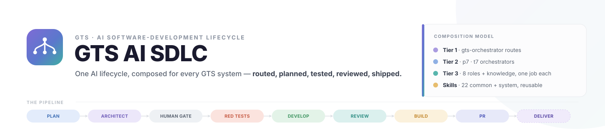

<p align="center">
  
</p>

<p align="center">
  
  
  
  
  
  
</p>

<p align="center">
  <b>A VS Code-based agentic SDLC</b> — specialist AI agents that run the full development lifecycle across <b>P7</b> and <b>T7</b>.
</p>

<p align="center">
  <a href="https://pages.github.deutsche-boerse.de/dev/gts.ai.sdlc/explorer/">
    
  </a>
  &nbsp;
  <a href="https://pages.github.deutsche-boerse.de/dev/gts.ai.sdlc/explorer/#setup">
    
  </a>
</p>

<h3 align="center">
  <a href="#where--when-you-use-it">Where &amp; When</a> &nbsp;·&nbsp;
  <a href="#architecture-at-a-glance">Architecture</a> &nbsp;·&nbsp;
  <a href="#the-sdlc-pipeline">The Pipeline</a> &nbsp;·&nbsp;
  <a href="#supported-systems">Systems</a> &nbsp;·&nbsp;
  <a href="#design-principles">Design</a> &nbsp;·&nbsp;
  <a href="#get-started">Get Started</a>
</h3>

<p align="center"></p>

## Where & when you use it

<p align="center">
  
</p>

Open the repo in VS Code and the whole team is already there — Copilot auto-discovers every
`.github/agents/*.agent.md`, so you run the **whole lifecycle** or call a **single phase** with zero setup.
The four ways in are shown above; you never need to know which orchestrator owns your change.

> **One writer, always gated.** Only the **developer** edits code — every other agent coordinates or reads.
> Nothing reaches a PR until the tester, reviewer and builder gates pass, and a single human gate confirms
> the plan before any code is written.

<p align="center"></p>

## Architecture at a glance

The framework is a **3-tier composition model**: a generic router on top, one orchestrator per system in
the middle, and single-purpose pipeline agents at the bottom — all drawing on shared **skills**. Alongside
them sits a read-only analysis peer, **`gts-issue-analyst`**, that diagnoses engineering signals and feeds the pipeline.

<p align="center">
  
</p>

<p align="center"></p>

## The SDLC pipeline

Each system binds the same lifecycle to its own agents. Every Tier 3 worker ends its turn with a
**status code**, and the orchestrator routes on it — that status contract is what makes the pipeline
autonomous yet gated.

<p align="center">
  
</p>

**Two shapes, one contract.** P7 runs this straight through as a **linear TDD pipeline**; T7 runs it as an
**autonomous Ralph loop** — specs are the source of truth, the plan is disposable, and each iteration
converges one task under tester + builder backpressure.

<p align="center"></p>

## Supported systems

<p align="center">
  
</p>

> **T7 adds a knowledge agent.** `t7-sdlc-knowledge` answers read-only "where / who owns / what changed"
> questions directly — no plan, gate or build cycle.
>
> **Signals get a read-only analyst.** `gts-issue-analyst` — a cross-system peer of the knowledge agent —
> diagnoses a red Jenkins build, a SonarQube finding, a Dependabot/CodeQL/secret alert, a GitHub issue or a
> Jira SIR (selecting jenkins-lens / sonarqube-lens / GitHub), grounds it in the code, and hands any fix
> back to the pipeline. It **diagnoses, never implements**.
>
> **Specs are on-demand.** `{system}-sdlc-spec-author` runs *after* planning to produce formal
> **DFS / DTS / SRQ** under `specs/{system}/` — separate from the lightweight plan the planner writes, and
> reusing the shared `spec-authoring` skill so every system follows the same corporate standard.

<p align="center"></p>

## Design principles

<p align="center">
  
</p>

Not marketing lines — each of these is enforced in the agent and skill definitions themselves, not left to
the model's discretion.

---

## Get started

<table align="center">
  <tr>
    <td align="center" width="360">
      <a href="https://pages.github.deutsche-boerse.de/dev/gts.ai.sdlc/explorer/">
        
      </a>
      <br><sub>Browse every agent, skill &amp; guided example in your browser.</sub>
    </td>
    <td align="center" width="360">
      <a href="https://pages.github.deutsche-boerse.de/dev/gts.ai.sdlc/explorer/#setup">
        
      </a>
      <br><sub>Jump straight to the VS Code setup steps.</sub>
    </td>
  </tr>
</table>

The framework needs no build step — it *is* the agent and skill definitions. To use it:

1. **Open this repo in VS Code** with GitHub Copilot (Agent mode). Every `.github/agents/*.agent.md` is
   auto-discovered as a callable subagent.
2. **Describe your task in Copilot Chat.** Start broad and let routing take over, or target a system:

   ```
   /gts-orchestrator   Fix the SMP Type-B reason code on cancel in T7
   /p7-orchestrator    Add a validation rule to the pricing-engine request handler
   /t7-sdlc-knowledge  Who owns the Matcher, and where does the order lifecycle live?
   /p7-sdlc-reviewer   Review the diff on this branch
   ```

3. **Confirm the plan at the human gate**, then let the pipeline run its RED → GREEN → review → build →
   PR loop to a reviewed, evidence-linked change.

---

## License

Internal to Deutsche Börse AG — see [`LICENSE.md`](LICENSE.md).
